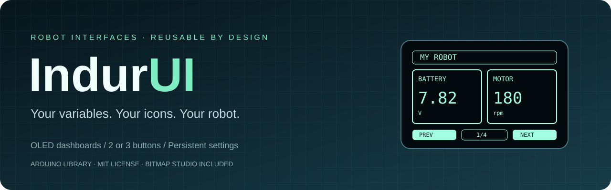
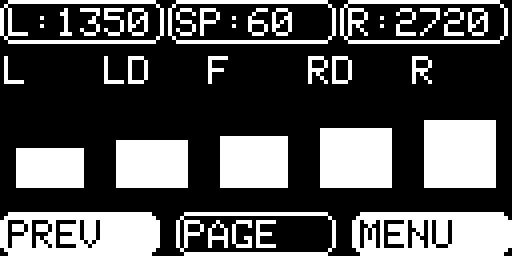
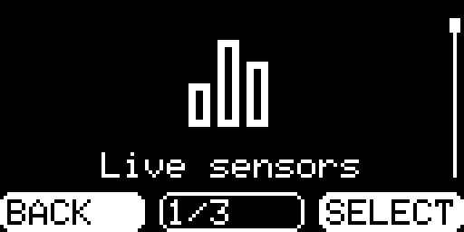
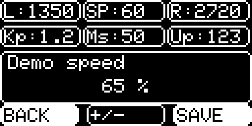
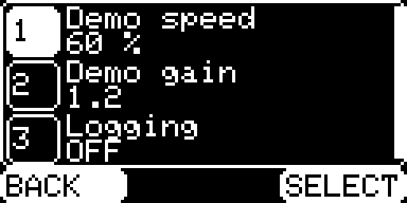
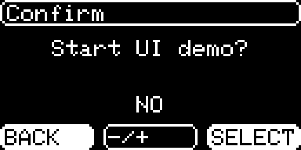
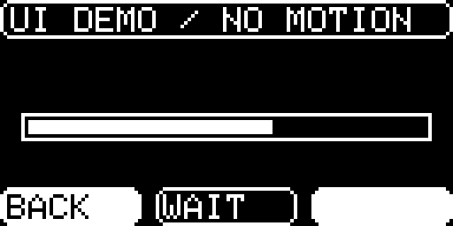
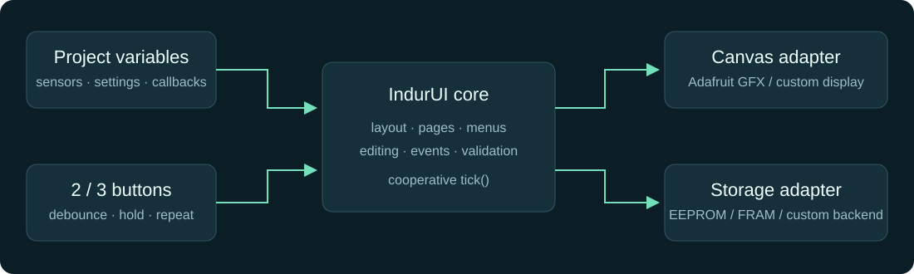

<p align="center"></p>

<p align="center">
  <a href="https://github.com/RakibulIslam1/indur-ui/actions/workflows/checks.yml"></a>
  <a href="https://github.com/RakibulIslam1/indur-ui/releases"></a>
  <a href="LICENSE"></a>
  
</p>

# IndurUI

**[Open Bitmap Studio in your browser →](https://rakibulislam1.github.io/indur-ui/)** — convert images, preview your OLED icon, and download a library-ready header. No installation or image upload required.

An Arduino OLED interface library for robots, instruments, and controllers on supported ESP32 and large classic AVR targets. Register your own variables, choose two or three buttons, and let IndurUI arrange the dashboard and settings screens.

The design grows out of a working robot interface: rounded panels, an icon menu, scrolling settings, short and long button presses, and values that survive a restart. The reusable library brings those interactions into a cooperative UI core with display and storage adapters.

## See the interface

| Live dashboard | Icon menu | Settings editor |
| :---: | :---: | :---: |
|  |  |  |
| Bind your project variables | Replace any item's icon | Preview, save, or cancel |

| Scrolling settings | Confirmation | Progress |
| :---: | :---: | :---: |
|  |  |  |

These exact 128×64 framebuffer captures use the real IndurUI core and Adafruit GFX renderer with fixed demo values, including its actual 6×8 font. Explore all twelve screens and capture your own device in the [OLED Lab](https://rakibulislam1.github.io/indur-ui/#oled-lab).

## What is included

- **Adaptive dashboards:** numeric values, bars, booleans, computed values, and text callbacks. Widgets resize to the available space and continue onto automatic pages.
- **Two or three buttons:** debounced input, short/long presses, three-button editor repeat, and stuck-button reporting. You can also supply events from an encoder, keypad, or other input.
- **Structured menus:** icon carousel or scrolling list, nested folders, actions, grouped settings, disabled items, and custom pages.
- **Typed settings:** numbers, toggles, and choices bound to application variables. Editing stages changes until Save; Cancel preserves the current value.
- **Persistence:** configurable EEPROM region, stable setting keys, CRC validation, two journal banks, defaults, and a custom storage interface.
- **Custom graphics:** eight built-in icons, flash/RAM bitmaps, aspect-preserving scaling, and **Bitmap Studio**, a desktop and CLI converter.
- **SSD1306 and SH1106 OLEDs:** use Adafruit SSD1306 or Adafruit SH110X with the same GFX canvas. A dedicated example covers 128×64 SH1106 modules commonly sold as 1.3-inch displays.
- **Robot workflow tools:** nonblocking splash screens, notifications, progress views, confirmation prompts, diagnostics pages, and change callbacks.
- **Six generic examples and a complete mini robot test, API documentation, native tests, and ESP32-S3/AVR compile checks.**

There is no fixed five-sensor dashboard or project-specific setting list. Register the items your application needs; RAM and display space determine capacity. Pages handle display overflow.

## Organize it like the original interface

Version 1.2 restores compact status strips, separate sensor pages, three numbered settings rows, and live telemetry above the editor. Menu position survives returning from a page. Visual style and button controls remain separately configurable.

```cpp
ui.addStatus("SP", speed);                 // Shared home/editor status strip
ui.addContext("Err", error, "", 1, 1);     // Live context while editing group 1
ui.setWidgetGroup(ui.addValue("Temp", temperature, "C", 1), 1);
ui.addDashboard("System data", 1, indur::DashboardLayout::Cards);
ui.setInputStyle(indur::InputStyle::Original);
```

The Original control profile keeps left-increase/right-decrease editing and hold-to-save/back with either button count. The default Standard profile retains conventional direction and three-button repeat. Bind all six home gestures with `bindHomeButton`, select Auto/Cards/Bars/Arc content layouts, and keep engineering-unit formats with `setSettingFormatter`. See the [original-style and content guide](docs/ORIGINAL_STYLE.md) for complete examples and layout rules.

## Choose a compatible MCU first

| Target | Status |
| --- | --- |
| ESP32-S3 / ESP32-S3-DevKitC-1 | All six generic examples compile in CI |
| ATmega2560 / Arduino Mega 2560 | All six generic examples compile in CI; budget its 8 KiB SRAM carefully |
| Other ESP32 targets or classic AVR with ≥8 KiB SRAM and ≥64 KiB flash | Accepted by the target policy, not individually verified |
| Classic ATmega328P/ATmega168 Nano, Uno, Pro Mini; ATmega32U4 boards | Unsupported; compile-time memory gate rejects them |
| Other Arduino architectures | Not supported by this release; a validated port is required |

The **classic Nano** has 2 KiB SRAM. A 128×64 SSD1306 framebuffer alone needs 1 KiB, before UI metadata, settings, stack, and application code. Flash-backed icons help with bitmap storage but do not eliminate these other costs. The **Nano ESP32** is a different board using ESP32-S3; it belongs to the accepted ESP32 family, with board-specific configuration still required.

Read the [MCU compatibility and memory guide](docs/COMPATIBILITY.md) before choosing hardware. Build-tested means compilation, not physical certification. For a beginner walkthrough covering installation, wiring, data, settings, buttons, icons, and persistence, use the [user guide](docs/USER_GUIDE.md).

## Install

### Arduino IDE

1. Open **Library Manager**, search for **IndurUI** by **Rakibul Islam**, and install it with dependencies.
2. For SSD1306 open **File → Examples → IndurUI → QuickStart**. For a 128×64 SH1106/SH1106G module, open **SH1106Display**, which uses **Adafruit SH110X**.
3. Adjust the OLED address, I²C configuration, and button pins for your board. See the [display setup guide](docs/DISPLAYS.md).

IndurUI is registered in Arduino Library Manager. New versions appear after Arduino's index refresh. To install **1.3.0** immediately, download **IndurUI-1.3.0.zip** from [Releases](https://github.com/RakibulIslam1/indur-ui/releases/latest), then choose **Sketch → Include Library → Add .ZIP Library…**. Install **Adafruit GFX Library**, **Adafruit SH110X** or **Adafruit SSD1306**, and **Adafruit BusIO** if needed.

### PlatformIO

Add these dependencies to your existing Arduino environment:

```ini
lib_deps =
    https://github.com/RakibulIslam1/indur-ui.git#v1.3.0
    adafruit/Adafruit SSD1306@^2.5.17
    adafruit/Adafruit GFX Library@^1.12.6
    adafruit/Adafruit BusIO@^1.17.4
```

Use your project's normal `platform`, `board`, and `framework = arduino`. The repository's own `platformio.ini` builds its example test harness.

For SH1106, select `adafruit/Adafruit SH110X@^2.1.15` as your display driver instead. The [SH1106Display example](examples/SH1106Display/SH1106Display.ino) shows its different `begin(address, reset)` call and supports two or three buttons. Select by controller, not screen diagonal alone.

## Your first dashboard

```cpp
#include <Wire.h>
#include <Adafruit_SSD1306.h>
#include <IndurUI.h>
#include <IndurUIGFX.h>
#include <IndurUIButtons.h>

Adafruit_SSD1306 display(128, 64, &Wire, -1);
indur::GfxCanvas<Adafruit_SSD1306> canvas(display);
indur::UI ui(canvas, "My Robot");
indur::Buttons buttons(ui, 2, 3, 4); // left, right, center; connect each to GND

float battery = 7.82f;
int speed = 80;
bool enabled = false;

void setup() {
    Serial.begin(115200);
    Wire.begin();
    if (!display.begin(SSD1306_SWITCHCAPVCC, 0x3C)) return;

    ui.addValue("Battery", battery, "V", 2);
    ui.addValue("Speed", speed, "%", 0);
    ui.addValue("Enabled", enabled);
    ui.addNumber("speed", "Speed limit", speed, 0, 100, 5, "%");
    ui.addToggle("enabled", "Enabled", enabled);
    buttons.begin();
    if (!ui.begin()) Serial.println(ui.errorText());
}

void loop() {
    uint32_t now = millis();
    // Update sensors and run your application's cooperative tasks here.
    buttons.update(now);
    ui.tick(now);
}
```

Settings appear in the menu automatically when no explicit settings entry was registered. Tap the center button to enter the menu. A failed registration is reported by `ui.begin()` and `ui.errorText()`.

**Two buttons:** change only the constructor to `indur::Buttons buttons(ui, 2, 3);`. Tap to navigate or adjust; hold right and release to select/save; hold left and release to go back/cancel.

## Connect your hardware

| Connection | Example setup |
| --- | --- |
| OLED SDA / SCL | Your board's I²C pins; call `Wire.begin()` or its board-specific overload |
| OLED VCC / GND | Supply and logic voltage supported by your OLED and board |
| Left / right / center | Example GPIO 2 / 3 / 4, each switched to GND |
| Pull-ups | Internal pull-ups enabled by default; no center button required |
| OLED size and address | SSD1306 or SH1106 128×64 at `0x3C`; configure your module and matching driver |

Example GPIO numbers are placeholders, especially on boards with boot, flash, USB, or I²C pin restrictions. The library does not configure your display bus or claim these pins globally.

## Use your own variables

```cpp
ui.addValue("Encoder", encoderTicks, "ticks", 0);
ui.addBar("Pressure", pressure, 0, 100, "kPa");
ui.addNumber("gain", "Controller gain", gain, 0, 10, 0.1, "", 1);
ui.addChoice("mode", "Mode", modeIndex, modeNames, modeCount);
```

Arithmetic values up to eight bytes bind directly. Computed-number and text callbacks expose object fields, project strings, derived readings, and formatted statuses. Dashboard bindings are read-only; editable settings use explicit `addNumber`, `addToggle`, or `addChoice` registration. See [bindings and lifetime rules](docs/API.md#bindings-and-lifetimes).

For a compact sensor page:

```cpp
indur::Theme theme;
theme.minBarWidth = 24; // Five vertical sensor bars on a 128-pixel-wide OLED
ui.setTheme(theme);
for (uint8_t i = 0; i < sensorCount; ++i)
    ui.addBar(sensorNames[i], sensorValues[i], 0, 1023);
```

Add more readings and the library creates more pages. Use larger minimum widths for longer labels and detailed values. The [RobotDashboard example](examples/RobotDashboard/RobotDashboard.ino) combines sensor bars, computed temperature, encoder readings, status text, grouped settings, diagnostics, and an asynchronous calibration demonstration.

## Bring your own icons

Open the **[online Bitmap Studio](https://rakibulislam1.github.io/indur-ui/)**. Drop an image, adjust the size and preview, and download a `.h` file. Processing stays in your browser; no images are sent to a server. Retouch individual pixels, mirror or rotate, undo edits, and export PNG or a flash-backed Arduino header.

The **[OLED Lab](https://rakibulislam1.github.io/indur-ui/#oled-lab)** shows twelve exact framebuffer captures generated by the real library and Adafruit GFX with fixed demo values. Import a frame from your own robot, or use desktop Chrome/Edge USB capture with `MiniRobotTest`. Export native 128×64 or crisp enlarged PNGs. These are framebuffer pixels, not photographs.

For the offline desktop converter, use Python 3.10+:

```sh
python -m pip install -r tools/requirements.txt
python tools/bitmap_converter.py
```

Open an image, choose a size, adjust the preview, and save a header. Or convert from the terminal:

```sh
python tools/bitmap_converter.py docs/assets/robot-icon.png \
  --size 32x32 --padding 1 --name robotIcon \
  --output robotIcon.h --preview robot-preview.png
```

Then use it:

```cpp
#include "robotIcon.h"
indur::Id item = ui.addAction("Robot lights", toggleLights);
ui.setIcon(item, robotIcon);
```

The converter exports the library's exact 1-bit format, including non-byte-aligned widths. The default menu slot is 32×32; icons scale to fit while preserving aspect ratio. See [Bitmap Studio](docs/BITMAPS.md) for dimensions, fitting modes, memory use, and custom bitmap integration.

## Saved settings

`EEPROMStorage` wraps the board's EEPROM API; you choose the offset and region size. Register settings before attaching storage, then call `load()`. ESP32 applications initialize `EEPROM.begin(...)` first.

```cpp
#include <IndurUIEEPROM.h>
// After EEPROM initialization and ui.begin():
static indur::EEPROMStorage<decltype(EEPROM)> storage(EEPROM, EEPROM.length());
if (ui.attachStorage(storage, 64, 512, 1)) {
    indur::LoadResult result = ui.load();
    // Handle Loaded, Empty, and failures explicitly; see the complete example.
}
```

Accepted edits autosave when storage is attached. Unchanged settings skip storage writes. Failed saves roll back the edited value; loading stages and validates data before updating your variables. The two-bank journal can recover the previous valid bank after an interrupted byte-level update. On flash-emulated EEPROM, both banks may share an erase sector; this does **not** guarantee survival of power loss during a sector erase. [Storage details and recovery](docs/STORAGE.md) explain the format and limits.

## Examples and reference

| Start here | Demonstrates |
| --- | --- |
| [User guide](docs/USER_GUIDE.md) | Step-by-step installation, controls, bindings, settings, icons, and saves |
| [MCU compatibility](docs/COMPATIBILITY.md) | Supported targets, classic Nano exclusion, and complete memory budgeting |
| [OLED display setup](docs/DISPLAYS.md) | SSD1306 vs SH1106, driver initialization, 1.3-inch modules, mini variants |
| [Original-style content guide](docs/ORIGINAL_STYLE.md) | Status/context strips, dashboard groups, sensor arcs, home gestures, and tuning formats |
| [QuickStart](examples/QuickStart/QuickStart.ino) | Three buttons, values, bar, action, settings, splash |
| [SH1106Display](examples/SH1106Display/SH1106Display.ino) | 128×64 SH1106/SH1106G via Adafruit SH110X, sample sensors, contrast, two/three buttons |
| [TwoButtons](examples/TwoButtons/TwoButtons.ino) | Complete menu/editor navigation with two buttons |
| [PersistentSettings](examples/PersistentSettings/PersistentSettings.ino) | EEPROM region, save/load, change callback, confirmed defaults |
| [RobotDashboard](examples/RobotDashboard/RobotDashboard.ino) | Five sensors plus more pages, grouped settings, custom page, progress |
| [CustomIcons](examples/CustomIcons/CustomIcons.ino) | Converter-generated icon and configurable menu slot |
| [MiniRobotTest guide](docs/MINI_ROBOT_TEST.md) | ESP32-S3 mini wiring, two/three-button test builds, live IR/encoders, isolated NVS, USB screenshots |
| [API](docs/API.md) | Every public UI method, input mapping, layouts, backends |
| [Persistence](docs/STORAGE.md) | Journal format, migration, recovery, endurance |
| [Bitmap Studio](docs/BITMAPS.md) | GUI/CLI conversion and icon format |
| [Original interface mapping](docs/INTERACTIONS.md) | How the original robot UI facilities map to this library |
| [Contributing](CONTRIBUTING.md) | Tests, formatting, and reproducible assets |

## Architecture and limits



The core uses C++11 and can build on a host without Arduino. Arduino firmware also applies the target policy in `IndurUIBoard.h`. `GfxCanvas` adapts a monochrome Adafruit GFX-compatible display with `display()`. SSD1306 and SH1106G are exercised by the examples; other controllers need an appropriate compatible display adapter or a custom `Canvas`. The UI accepts displays from 64×32 through 1024×1024; labels shorten to fit and screens below 48 pixels high use compact layouts.

Registration uses heap memory. Frame rendering uses fixed local buffers and no library heap allocations; saving/loading/default reset need temporary buffers. Both OLED drivers also allocate a framebuffer. Compile reports exclude those runtime allocations. The classic Nano/Uno is unsupported, and small AVR targets are rejected during compilation. Passing the memory gate does not guarantee that a large application fits.

UI state changes and button polling do not contain wait loops or delays. Display transfers, EEPROM commits, and your callbacks still take execution time. Keep timing-critical motor control in an appropriate independent task/interrupt, provide coherent sensor snapshots, and call UI methods from one application context. The library is not an ISR or real-time scheduling framework.

## Verification

Native behavioral tests cover layout bounds, paging, navigation, editor cancellation, typed bindings, button timing/rollover, journal recovery, storage isolation, and injected read/write/flush failures. Converter tests check bit order, row padding, alpha handling, image fitting, generated headers, and file collisions. CI builds the six generic examples for ESP32-S3 and ATmega2560, four mini variants covering both OLED drivers and button counts on ESP32-S3, and checks expected rejection of small AVR targets using real MCU headers. Browser checks cover desktop/mobile layout, exact frame decoding, pixel edits, exports, imports, and a simulated Web Serial exchange. Captures are reproducibly generated from the core and unmodified Adafruit GFX 1.12.6.

These checks do not replace testing your actual display, wiring, button hardware, and storage during power interruptions. See [CONTRIBUTING.md](CONTRIBUTING.md) for exact commands.

Released under the [MIT license](LICENSE). Created by [Rakibul Islam](https://github.com/RakibulIslam1).
